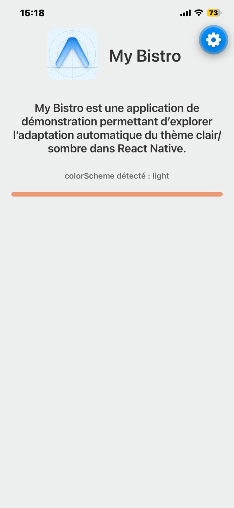

# My Bistro – ThemeHookApp

Application mobile simple développée avec **React Native** et **Expo**.
Elle montre comment adapter automatiquement le thème (clair / sombre) de l'application grâce au hook `useColorScheme`.

## Captures d'écran

 

## Fonctionnalités

- Détection automatique du thème du téléphone avec `useColorScheme`
- Affichage du thème détecté (`light` ou `dark`)
- Couleurs de l'interface qui s'adaptent au thème
- Écran d'accueil `WelcomeScreen` avec logo, titre et description

## Structure du projet

```
ThemeHookApp/
├── ScreenShots/           # Captures d'écran
├── src/
│   └── screens/
│       └── WelcomeScreen.js
├── App.js
├── index.js
├── app.json
└── package.json
```

## Installation et lancement

1. Installer les dépendances :

   ```bash
   npm install
   ```

2. Lancer l'application :

   ```bash
   npx expo start
   ```

3. Scanner le QR code avec l'application **Expo Go** sur le téléphone.

## Tester le thème sombre

Dans `app.json`, la propriété `userInterfaceStyle` doit être définie sur `automatic`.
Activer ensuite le mode sombre dans les réglages du téléphone, puis revenir dans l'application :
le texte affiché devient `colorScheme détecté : dark` et les couleurs changent.

## Technologies

- React Native
- Expo
- JavaScript

## Auteur

Marouane Chafiqi
